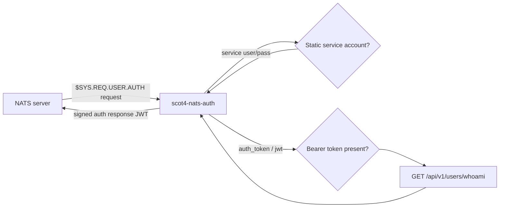
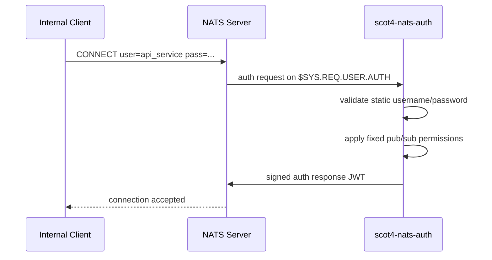
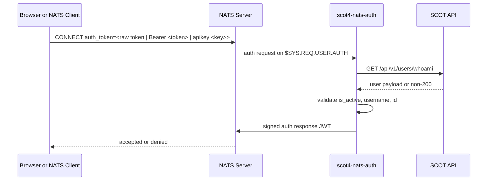

# scot4-nats-auth

NATS Auth Callout service for SCOT4.

This service connects **outbound** to the NATS server as the static user `auth_callout_service`, subscribes to `$SYS.REQ.USER.AUTH`, evaluates incoming auth requests, and returns signed auth responses back to NATS.

It currently supports two auth flows:
- static service-account auth for internal clients such as `api_service`
- token-based auth for end users by calling SCOT API `GET /api/v1/users/whoami`

## How It Works

### High-level flow

### Static service-account flow

### Token / API key flow

## Authorization Rules

### Static service accounts
- `api_service`
  - publish: `scot.irelement.>`, `scot.notification.>`, `scot.flair.regex.>`, `scot.flair.job.>`
  - subscribe: `scot.irelement.>`, `scot.notification.>`
- `flair_service`
  - publish: none
  - subscribe: `scot.irelement.>`, `scot.flair.regex.>`, `scot.flair.job.>`

### End-user token / API key auth
A token-authenticated user is allowed only when:
- a credential is present in the NATS auth request
- the credential is one of:
  - a raw token, treated as a bearer token for backward compatibility
  - `Bearer <token>`
  - `apikey <apikey>`
- `GET /api/v1/users/whoami` returns `200`
- `is_active == true`
- `username` exists
- `id` exists

If allowed, the user currently receives:
- publish: none
- subscribe: `scot.irelement.>`, `scot.notification.user.<user_id>.>`, `scot.notification.broadcast.>`

Browser clients should subscribe to those three patterns rather than `scot.>` so per-user notification subjects remain private.

For SCOT `whoami`, the service now forwards credentials as:
- raw token -> `Authorization: Bearer <token>`
- `Bearer <token>` -> `Authorization: Bearer <token>`
- `apikey <apikey>` -> `Authorization: apikey <apikey>`

This means API key users should pass the full `apikey <value>` string in the NATS token field.

## Dependencies

### Python runtime dependencies
From [requirements.txt](requirements.txt):
- `fastapi[standard]==0.136.3`
- `uvicorn[standard]==0.49.0`
- `httpx==0.28.1`
- `pydantic==2.13.4`
- `nats-py==2.15.0`
- `nats-callout==0.1.1`
- `nats-jwt==0.2.2`

### External system dependencies
- NATS server `2.14.x` with `authorization.auth_callout` enabled
- SCOT API reachable at `GET /api/v1/users/whoami`
- Kubernetes Secret containing:
  - `AUTH_CALLOUT_PASSWORD`
  - `API_SERVICE_PASSWORD`
  - `FLAIR_SERVICE_PASSWORD`
  - `NATS_AUTH_ISSUER_SEED`
  - optionally `NATS_AUTH_XKEY_SEED` for future encrypted-request support

## Required Environment Variables

### Core NATS callout settings
- `NATS_PROTOCOL`
- `NATS_HOST`
- `NATS_PORT`
- `NATS_AUTH_SUBJECT`
  - current default: `$SYS.REQ.USER.AUTH`
- `NATS_AUTH_ACCOUNT`
  - current default: `$G`
- `AUTH_CALLOUT_USERNAME`
- `AUTH_CALLOUT_PASSWORD`
- `NATS_AUTH_ISSUER_SEED`

### SCOT API validation settings
- `WHOAMI_URL`
  - current default: `http://scot4-api-service:8000/api/v1/users/whoami`
- `WHOAMI_TIMEOUT_SECONDS`
- `NO_PROXY`
- `no_proxy`

The proxy bypass variables are important in-cluster so `whoami` traffic does not get sent through the corporate proxy.

### Authorization/subject settings
- `NATS_SUBJECT_ROOT`
  - current default: `scot`
  - `NATS_SUBJECT_PREFIX` is still accepted only as a legacy compatibility input when deriving the root.
- `API_SERVICE_USERNAME`
- `API_SERVICE_PASSWORD`
- `API_SERVICE_PUBLISH_SUBJECTS`
- `API_SERVICE_SUBSCRIBE_SUBJECTS`
- `FLAIR_SERVICE_USERNAME`
- `FLAIR_SERVICE_PASSWORD`
- `FLAIR_SERVICE_PUBLISH_SUBJECTS`
- `FLAIR_SERVICE_SUBSCRIBE_SUBJECTS`

Default service-account permissions include:

- `api_service` publish: `scot.irelement.>`, `scot.notification.>`, `scot.flair.regex.>`, `scot.flair.job.>`
- `flair_service` subscribe: `scot.irelement.>`, `scot.flair.regex.>`, `scot.flair.job.>`

## NATS Server Configuration Expectations

This service assumes the NATS server is configured with:
- a static `auth_callout_service` user in `authorization.users`
- `authorization.auth_callout` enabled
- the matching `issuer` public key
- `auth_users` including `auth_callout_service`

## Health and Runtime Model
- The container starts a FastAPI process because that is the current runtime wrapper.
- On startup, the app connects to NATS and subscribes to `$SYS.REQ.USER.AUTH`.
- `/healthz` returns whether the NATS connection is established.
- Auth decisions are made from NATS message callbacks, not from HTTP POSTs.

## Local Development Notes
- The service code contains compatibility workarounds for the currently used `nats-callout` Python package.
- If you upgrade or replace that library, re-test:
  - request decoding
  - response signing
  - user JWT generation
- If you enable encrypted auth-callout requests later, revisit the `xkey` path before turning it back on in NATS config.

## Files of Interest
- [app/main.py](app/main.py): runtime startup and NATS subscription
- [app/callout_service.py](app/callout_service.py): auth-callout implementation
- [app/auth_logic.py](app/auth_logic.py): authorization decisions
- [app/whoami_client.py](app/whoami_client.py): SCOT API token validation call
- [app/settings.py](app/settings.py): environment variable contract
- [Dockerfile](Dockerfile): container build/runtime
